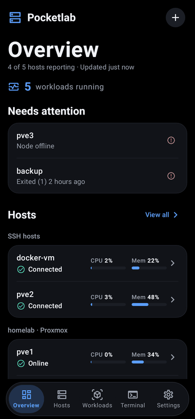
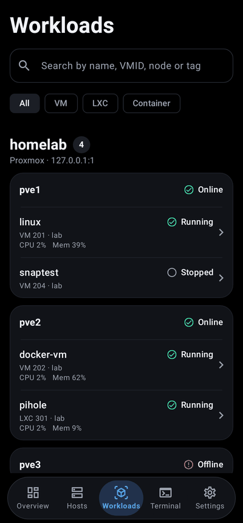
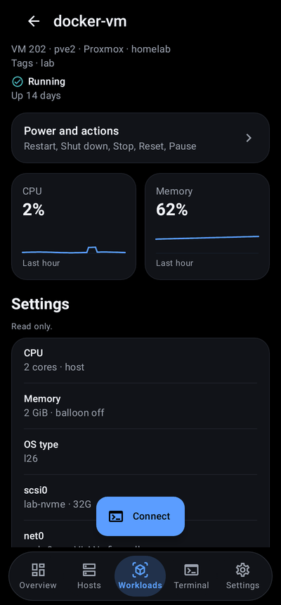
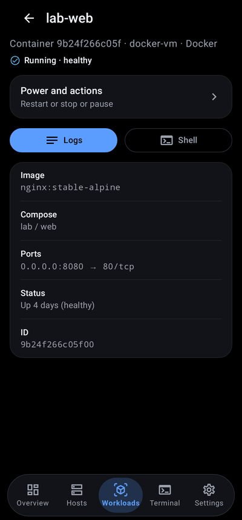
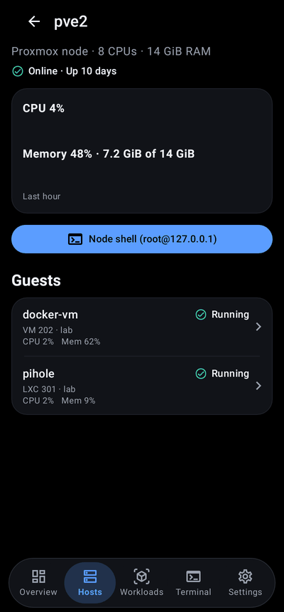
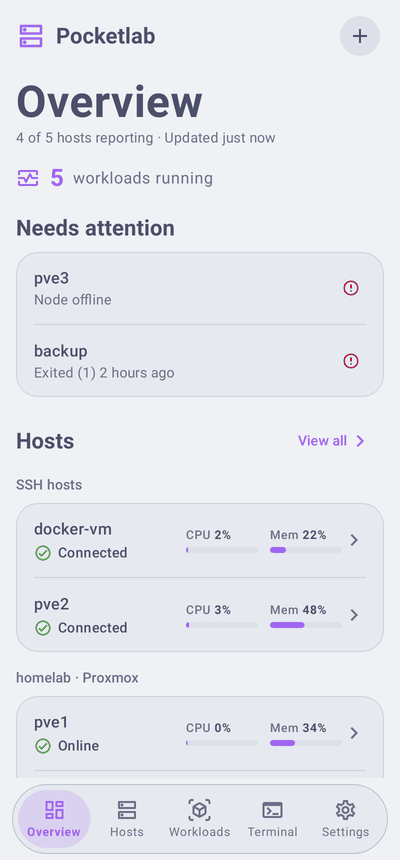
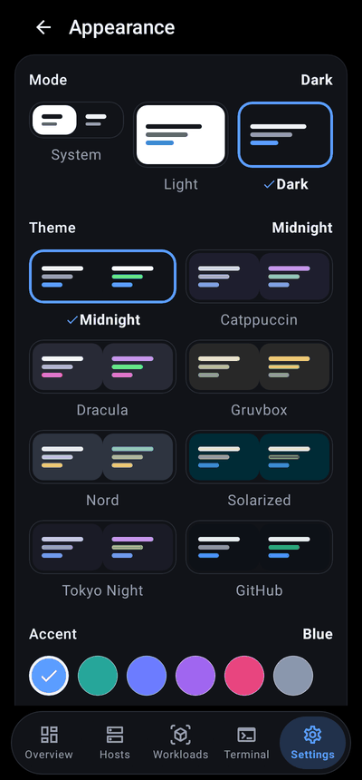
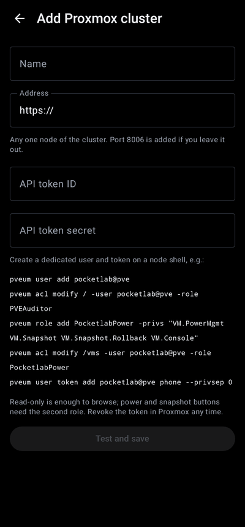
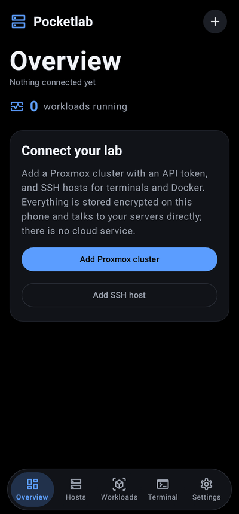

# Pocketlab

A phone app for your homelab: Proxmox VMs and containers, Docker containers, and SSH terminals.
Everything runs on the phone and talks straight to your servers. There is no cloud service, no account and no analytics.

## Screenshots

| Overview | Workloads | VM detail |
|:-:|:-:|:-:|
|  |  |  |
| **Container** | **Node** | **Light theme** |
|  |  |  |
| **Appearance** | **Add a Proxmox cluster** | **First run** |
|  |  |  |

These are rendered from the app's real UI code by the Robolectric smoke tests (`UiSmokeTest`), using sample data and a fake Proxmox API. To regenerate them, run `./gradlew testDebugUnitTest --tests dev.pocketlab.UiSmokeTest`; the full-size images land in `app/build/screens/`.

## What it does

- **Overview**: hosts reporting, running workloads, and a "needs attention" list (offline nodes, unhealthy or crashed containers, nodes with memory above 92%).
- **Proxmox** (REST API with an API token): lists nodes, VMs and LXCs with CPU and memory and a one-hour sparkline. It can start, shut down, reboot, stop, reset, pause and resume guests, take snapshots and roll back to them. Guest config is read-only.
- **Docker** (over SSH, with no exposed Docker socket): lists containers with health and Compose project. It can start, stop, restart and pause them, open a shell in a container with `docker exec`, and live-tail logs with search, match navigation, "only matches", and follow/pause.
- **Terminal**: a full xterm-256color emulator (ConnectBot's termlib, backed by libvterm) with an extra key row (Esc, Tab, sticky Ctrl/Alt, arrows, F-keys, Home/End/PgUp/PgDn) and pinch to zoom. Sessions stay open while you move around the app.
- **Consoles**: a node shell, `qm terminal <vmid>` for a VM's serial console, and `pct enter <vmid>` for an LXC, all over SSH to the node.
- **Themes**: System, light or dark mode; 8 palettes; 6 accent colours.

## Security model

- API tokens, passwords and private keys are kept in one file encrypted with AES-256-GCM. The key is a non-exportable Android Keystore key (hardware-backed where the phone supports it). Backups and device transfer are disabled.
- **SSH algorithms**: AEAD/CTR ciphers only (ChaCha20-Poly1305, AES-GCM, AES-CTR), curve25519/ECDH/strong DH key exchange, and SHA-2 MACs, with SHA-1 kept as a last resort. No CBC, RC4, 3DES, MD5 or DSA.
- **Proxmox TLS**: a publicly trusted cert is accepted as normal. A self-signed cert (the Proxmox default) is shown to you with its SHA-256 fingerprint. Once you trust it, only that exact cert is accepted and any change is refused until you approve it again.
- **SSH host keys**: trust on first use, with the same `SHA256:` fingerprint `ssh-keygen -lf` prints. If the key changes, the connection is refused and you get a man-in-the-middle warning.
- Screens are marked secure (`FLAG_SECURE`): they don't appear in the recents thumbnail, screenshots or screen recordings.
- Secret fields use a password keyboard with autocorrect off, so the keyboard doesn't learn or sync them.
- If saved settings can't be decrypted, the file is kept under a unique name and the app says so. A temporary Keystore error never overwrites them.
- Every remote command has a deadline and SSH uses real keep-alives, so a hung `docker` or a dropped Wi-Fi link can't freeze polling. Power actions are never retried after they were sent.
- Cleartext HTTP is disabled app-wide. The app's only permission is `INTERNET`.

## Setup

### Proxmox API token (least privilege)

On any node:

```sh
pveum user add pocketlab@pve
pveum acl modify / --users pocketlab@pve --roles PVEAuditor
pveum role add PocketlabPower --privs "VM.Audit VM.PowerMgmt VM.Snapshot VM.Snapshot.Rollback"
pveum acl modify /vms --users pocketlab@pve --roles PocketlabPower
pveum user token add pocketlab@pve phone --privsep 0
```

`phone` is the token name: pick one per device (`tablet`, `pixel8`…) so you can revoke one device without the others. In the app you only enter that name (the token ID becomes `pocketlab@pve!<name>`) and the printed secret; the app's **First time?** section gives you these commands with your token name filled in. Skip the `PocketlabPower` lines for a read-only token. Revoke a token in Proxmox under Datacenter → Permissions → API Tokens. To use another user or an existing token, tap **Use a different user or token** and enter the full ID.

### SSH

**Settings → How to set up** walks through all of this on one screen.

In **Settings → SSH keys → Generate Ed25519**, copy the public key into `~/.ssh/authorized_keys` on each host, then add the host.

- Add each Proxmox node as an SSH host to get the node shell and a console for every VM and LXC. The "Proxmox node" choice is picked for you when the name or address matches; with more than one cluster, check it's the right one: Pocketlab won't guess between two nodes that share a name.
- **Docker in an LXC:** open the LXC and turn on "Docker in this container". Pocketlab runs Docker inside it through the node's SSH host (`pct exec`), so the LXC needs no SSH server or key.
- **Docker in a VM:** add the VM as its own SSH host, named like the VM, with Docker on. Docker needs the user in the `docker` group, or turn on "Use sudo for docker" (passwordless sudo for docker). Naming it after the VM also gives "SSH into the VM" on its Connect button.

## Build

Needs JDK 17+ and Android SDK platform 37.

```sh
./gradlew assembleRelease        # app/build/outputs/apk/release/app-<abi>-release.apk (~3.5 MB each)
./gradlew testDebugUnitTest      # Proxmox client + UI smoke tests (Robolectric)
```

Install `app-arm64-v8a-release.apk` on any phone from roughly 2017 onwards; `armeabi-v7a` is for old 32-bit phones and `x86_64` for emulators.

`scripts/r8-probe.sh` re-runs the release shrinker in class-file mode and drives the shrunk SSH, Docker and crypto code against a real sshd. Use it after changing keep rules or dependencies.

Release signing reads `keystore.properties` (gitignored):

```
storeFile=pocketlab-release.jks
storePassword=...
keyAlias=pocketlab
keyPassword=...
```

Keep that keystore. Android only installs an update over an existing install if it is signed with the same key.

### CI and releases (GitHub Actions)

- **Every PR / push to `main`** (`.github/workflows/android.yml`): unit tests + the `dev` build, which is the release build (same R8 shrinking) under its own app ID, `dev.pocketlab.dev`, named **Pocketlab Dev**. It installs next to the real app with its own settings, so you can try a PR without touching your real install: open the run → Artifacts → `pocketlab-dev-N` → unzip → install the `arm64-v8a` APK. Dev builds are signed with the release key when the secrets are available, so each one updates the last. Dependabot PRs get no secrets, so theirs are debug-signed (uninstall Pocketlab Dev first).
- **Tag `vX.Y.Z` on `main`** (`.github/workflows/release.yml`): tests, builds APKs signed with your release key, refuses to publish anything debug-signed, and creates a GitHub Release with the APKs and `SHA256SUMS.txt`. The version name comes from the tag; the version code is `X*1000000 + Y*1000 + Z`, so every tag must be higher than the last.

Release secrets (Settings → Secrets and variables → Actions): `KEYSTORE_BASE64` (`base64 -w0 pocketlab-release.jks`), `KEYSTORE_PASSWORD`, `KEY_ALIAS`, `KEY_PASSWORD`.

The SSH integration test runs against a real sshd. Set `POCKETLAB_TEST_SSHD` to a directory with `authorized_keys` and `hostkey.pub`, run sshd on `127.0.0.1:2222`, and see `SshIntegrationTest` for the details.

## Not done yet

- Proxmox noVNC/SPICE graphical console. Use the serial console or SSH instead.
- Editing VM settings, creating or cloning guests, and backups.
- Biometric app lock.
